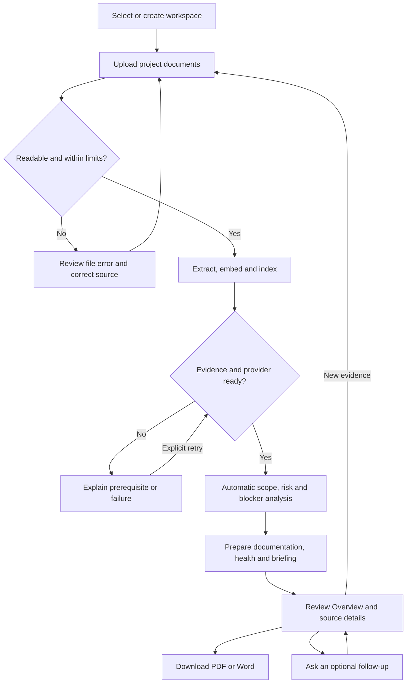
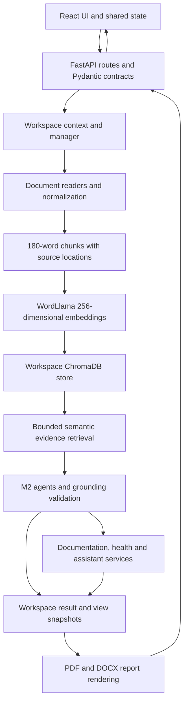

# AI Project Intelligence & Risk Advisor

**Product Requirements Document**

## 1. Document information

| Field | Value |
| --- | --- |
| Document | Product Requirements Document (PRD) |
| Document version | 1.0 — initial source-aligned PRD |
| Date | 12 October 2026 |
| Status | Prepared for mentor review; not a release sign-off |
| Product baseline | Existing unified M1–M4 application, including the final risk-point interaction patch |
| Intended audience | Infosys Springboard internship evaluators, mentors, project reviewers, developers, and testers |
| Source baseline | Current `AI-Project-Intelligence` project corresponding to `AI-Project-Intelligence-Final-UI.zip`, with the separately updated root README |
| Change boundary | Documentation only: create `PRD.md`; preserve all other project files |
| Verification basis | Source, schemas, dependency manifests/locks, samples, tests, and existing verification reports inspected; no application tests executed for this PRD |

### Status and priority conventions

- **Implemented:** a corresponding implementation exists in the inspected source. This does not mean all acceptance checks have passed.
- **Partially implemented:** only the explicitly described part of a broader capability exists.
- **Planned:** an approved requirement without implementation. No additional committed roadmap is established by the inspected source.
- **Proposed:** a suggestion or acceptance target in this PRD, not an approved commitment or delivered capability.
- **Reported verification:** an outcome recorded in an existing report, not a newly executed test.

**P0** means essential to correctness, evidence integrity, or data separation. **P1** means important to the review/demo workflow. **P2** means supporting usability. Priorities in this document are proposed product-management priorities; they are not historical sprint assignments or MoSCoW records.

### Contents

1. [Document information](#1-document-information)
2. [Executive summary](#2-executive-summary)
3. [Problem statement](#3-problem-statement)
4. [Vision and objectives](#4-product-vision-and-objectives)
5. [Target users](#5-target-users-and-personas)
6. [Scope](#6-scope)
7. [Functional requirements](#7-functional-requirements)
8. [Non-functional requirements](#8-non-functional-requirements)
9. [User stories and acceptance criteria](#9-user-stories-and-acceptance-criteria)
10. [User workflow](#10-user-workflow)
11. [System architecture](#11-system-architecture)
12. [Technology stack](#12-technology-stack)
13. [Data and document requirements](#13-data-and-document-requirements)
14. [Risk analysis and health scoring](#14-risk-analysis-and-project-health-scoring)
15. [API requirements](#15-api-requirements)
16. [UI/UX requirements](#16-uiux-requirements)
17. [Testing and acceptance](#17-testing-and-acceptance-testing)
18. [Milestones](#18-milestones)
19. [Constraints and limitations](#19-constraints-assumptions-and-limitations)
20. [Future enhancements](#20-future-enhancements)
21. [Success criteria](#21-success-criteria)
22. [Conclusion](#22-conclusion)

## 2. Executive summary

AI Project Intelligence & Risk Advisor helps reviewers understand a project through its documents. Users upload proposals, requirements, meeting notes, progress updates, and task lists. The application indexes their text, retrieves relevant passages, and organizes supported information into scope, risk, blocker, action, documentation, health, and conversational views.

The product combines a React frontend, FastAPI backend, WordLlama embeddings, and a persistent ChromaDB vector store. The default analysis provider uses deterministic extraction rules without a live external language model or API key. An optional compatible chat-completions provider is implemented behind the same evidence-validation boundary.

The final experience includes automatic preparation after indexing, an executive Overview, a Probability × Impact risk matrix, separate project workspaces, and PDF/Word export. Its value is traceability: users can inspect the passage behind a finding and see where information is missing.

“Recommendations” in this product are grounded source actions, mitigations, and review guidance. It does not autonomously assign tasks, invent commitments, forecast delivery probability, or produce unrestricted project advice. Implementation is present across M1–M4; final regression and rendered-browser acceptance are not fully cleared in the available records.

## 3. Problem statement

Project information is distributed across formats and documents. Manual review creates several difficulties:

- Scope, milestones, owners, and deadlines must be assembled from separate sources.
- Risks and dependencies can be buried inside narrative updates.
- Blockers may appear in meeting notes while related tasks appear in CSV files.
- Missing information can be mistaken for confirmation that everything is healthy.
- Summaries can lose their connection to original evidence.
- Repeated preparation of review documents takes effort and can introduce unsupported statements.

The application addresses these problems by organizing retrieved evidence and making uncertainty explicit. It does not establish whether source documents are objectively correct or replace human review of conflicting statements.

## 4. Product vision and objectives

**Vision:** provide one understandable, evidence-grounded workspace for reviewing project scope, delivery concerns, actions, and health.

| Objective | Intended product outcome | Measurement approach |
| --- | --- | --- |
| Consolidate documents | Supported formats enter the same project knowledge base | Cross-format ingestion and provenance checks |
| Preserve evidence | Findings and generated items link to source quotations | Validate returned references against retrieved passages |
| Expose uncertainty | Missing details remain unknown | Negative, incomplete, and contradictory-evidence cases |
| Reduce manual preparation | Analysis and default intelligence prepare after indexing | Observe the workflow without pressing Generate |
| Explain project health | Users can inspect dimensions, weights, and calculations | Deterministic calculation and unknown-input tests |
| Support project separation | Switching workspaces restores only that project's state | Two-workspace isolation and restart checks |
| Improve review and sharing | Overview is concise and reports preserve available information | Mentor walkthrough and PDF/Word content comparison |

No measured time savings, accuracy percentage, user adoption, or performance improvement is established by the repository. Those require a separately defined evaluation.

## 5. Target users and personas

These are intended-use personas, not claims of completed user research. They do not correspond to implemented access-control roles.

| Persona | Main need | Typical interaction | Product boundary |
| --- | --- | --- | --- |
| Project manager / reviewer | Understand documented delivery concerns and actions | Review Overview, inspect evidence, export a report | No automated delivery guarantee or task assignment |
| Team lead | Identify dependencies, blockers, responsibilities, and scope gaps | Open analysis pages and review focus-specific results | No live task-system synchronization |
| Project member | Find supported commitments and requirements | Review action owners/dates or ask a project question | No personal account or private role-based workspace |
| Internship mentor / evaluator | Understand architecture and verify traceable outputs | Upload the recommended samples, inspect findings and methodology | Demo evidence is fictional, not actual internship history |

## 6. Scope

### In scope

The current product supports document ingestion, semantic evidence retrieval, three M2 agents, documentation generation, deterministic health scoring, bounded conversational assistance, automatic coordination, executive summaries, risk visualization, incremental uploads, workspace persistence, themes, notifications, and saved-result exports.

The retrieval and knowledge-base APIs remain implemented. **Knowledge Base and Evidence Search are not current sidebar destinations or frontend routes.** Their earlier page files do not establish a currently accessible navigation feature.

### Out of scope for the current baseline

- User accounts, authentication, authorization, role permissions, and secure multi-tenant hosting.
- OCR for scanned PDFs, encrypted-PDF processing, or arbitrary file formats.
- Document deletion, reindex controls, original-file preview/download, and automatic source replacement.
- Unrestricted generative conversation, unsupported recommendations, delivery predictions, or inferred risk ratings.
- External project-management integrations, email notifications, or automatic assignment of work.
- A durable background job queue, multi-worker deployment guarantees, or resumed interrupted uploads.
- Historical risk trends, independently verified incident counts, and immutable audit history.

### Partial capability boundaries

| Broader capability | Current status | Exact boundary |
| --- | --- | --- |
| General conversational intelligence | Partially implemented | Supported English project intents, bounded follow-ups, source quotations, and derived health responses; no unrestricted chat |
| Project history | Partially implemented | Saved results/view state persist; not every past run is preserved as an immutable version |
| Duplicate prevention | Partially implemented | Queue/session content checks exist; no permanent cross-session document-deduplication guarantee |
| Enterprise deployment security | Not implemented | Local workspace partitioning exists; authenticated tenant isolation does not |
| Final release verification | Incomplete | Existing reports contain unresolved frontend and browser-validation limitations |

## 7. Functional requirements

“Shall” describes the expected behavior to preserve and accept. Implementation evidence is a code reference, not a claim of test completion.

| ID | Priority | Requirement | Status and implementation evidence |
| --- | --- | --- | --- |
| FR-01 | P0 | Accept PDF/DOCX/CSV/TXT uploads, enforce limits, and return per-file status/errors without treating partial failure as full success. | Implemented — `api/router.py`, `services/text.py`, Documents and SessionContext |
| FR-02 | P0 | Normalize text and create 180-word chunks with 30-word overlap while retaining page/block/row/section provenance. | Implemented — `services/text.py`, `core/config.py` |
| FR-03 | P0 | Embed with WordLlama `l2_supercat` 256 and retrieve workspace evidence from persistent ChromaDB. Return insufficient information when no relevant passage qualifies. | Implemented — `services/embeddings.py`, `services/knowledge_base.py` |
| FR-04 | P0 | Extract goals, deliverables, milestones, timelines, and responsibilities with evidence references. | Implemented — `agents/scope_deliverables.py`, shared grounding |
| FR-05 | P0 | Extract schedule risks, dependency gaps, delivery challenges, and stated delivery outlook without predicting missing dates/probabilities. | Implemented — `agents/risk_forecast.py` |
| FR-06 | P0 | Identify pending decisions, unresolved issues, and actions; preserve supported owner/date/status and unknown fields. | Implemented — `agents/blockers_actions.py`, `agents/extraction.py` |
| FR-07 | P0 | Produce user-story drafts, risk entries, and action lists from explicit requirements/findings; retain at least one source reference per item. | Implemented — `agents/documentation.py`, `intelligence/schemas.py` |
| FR-08 | P0 | Calculate the unchanged explainable health model; never convert absent evidence into a healthy overall score. | Implemented — `services/project_health.py` |
| FR-09 | P1 | Prepare a briefing and answer supported project questions; conversation history supplies context, not project facts. | Implemented within the bounded assistant scope — `services/assistant.py`, `IntelligenceContext.tsx` |
| FR-10 | P1 | Present concise Overview summaries with links to full results and evidence. | Implemented — `dashboard/ProjectInsights.tsx`, `ExecutiveSummary.tsx` |
| FR-11 | P0 | Group unambiguous documented Risk IDs while retaining supporting evidence and separate observations; position only explicitly supported ratings. | Implemented — `dashboard/canonicalRisks.ts`, risk metadata and matrix modules |
| FR-12 | P1 | Provide compact point hints and inline full details in Positioned risk records; preserve keyboard/touch access and selection state. | Implemented — `RiskPointTooltip.tsx`, `RiskPriorityMatrix.tsx`, `RiskDetailsDialog.tsx` |
| FR-13 | P0 | Automatically prepare analysis/intelligence after readiness; cache valid results, guard duplicate/stale requests, and offer explicit retry. | Implemented — `experience/useAutomaticAnalysis.ts`, `AutomaticResource.ts`, session/intelligence contexts; regression caveats in §17 |
| FR-14 | P0 | Append incremental documents without removing prior evidence; invalidate older insights and preserve useful stale content with labels. | Implemented — knowledge-base service and source-revision coordination |
| FR-15 | P0 | Create and switch isolated workspaces; preserve the original legacy store and workspace-specific documents/results. | Implemented — `workspaces/` backend and frontend modules |
| FR-16 | P1 | Export saved project information as PDF or DOCX, including evidence, unknown fields, generation metadata, and stale-section labels. | Implemented — `exports/report.py`, `exports/render.py`, `ExportMenu.tsx` |
| FR-17 | P1 | Keep workflow/export on Overview only; show actual processing, failure, waiting, and readiness states. | Implemented — `experience/ProjectFlow.tsx`, Overview composition |
| FR-18 | P2 | Preserve light/dark themes, responsive navigation, reduced-motion support, and accessible controls. | Implemented styling/handlers — `presentation/`, `App.tsx`; rendered acceptance pending |
| FR-19 | P1 | Emit notices only for real events; dismiss after approximately 2.5 seconds of unpaused display with manual close and bounded stacking. | Implemented — `experience/Notifications.tsx`, notification state |

### Automatic coordination requirements

The active workspace must have indexed evidence and an available provider before automatic analysis starts. Uploading/indexing and connection/provider errors block unproductive execution. M2 results precede default intelligence preparation.

The default documentation and health resources are shared across Overview and intelligence pages. Briefing requests include internal delivery-outlook and blocker questions; these are not represented as user-entered chat. Optional custom focuses remain available.

Source changes invalidate earlier versions. Late responses must not overwrite current results, and failures must preserve useful previous content with clear labels. No endless polling/retry loop is required. Existing M3 services compose M2 agents internally, so frontend reuse does not imply that all backend computations are reused. Automatic processing depends on the running application, not a scheduler that operates after the UI closes.

## 8. Non-functional requirements

| ID | Area | Source-confirmed provision | Proposed acceptance target / unverified aspect |
| --- | --- | --- | --- |
| NFR-01 | Usability | Summary-first Overview; details/evidence disclosures; clear missing/error states | Mentor can complete upload → review → export without manually generating each view; evaluate through a walkthrough |
| NFR-02 | Accessibility | Semantic controls, ARIA state, focus handling, mobile-menu dismissal, reduced-motion CSS | Complete keyboard walkthrough at desktop and narrow widths; no inaccessible risk record. No formal WCAG conformance is claimed |
| NFR-03 | Performance | Embedding batches of 64, bounded retrieval, shared caches and duplicate-request guards | Establish timing baselines on a specified machine/dataset before setting latency or throughput budgets; none is measured here |
| NFR-04 | Reliability | Per-file rollback, interrupted-index recovery, atomic JSON writes, locks, source-version guards | Verify failed uploads preserve earlier evidence; verify restart restoration and outdated-response rejection |
| NFR-05 | Maintainability | Separate API, schema, service, agent, provider, workspace and presentation modules; typed contracts and tests | New changes retain existing regression coverage and pass clean build/test processes before release |
| NFR-06 | Privacy | Default extraction provider makes no LLM API request; browser persistent storage excludes evidence; extracted content persists locally | Review sensitive content before upload/export; document retention/backups. No encrypted-at-rest guarantee is implemented |
| NFR-07 | Security | Filename sanitization, input/size validation, provider URL restrictions, workspace registry/header checks, grounding validation | Restrict use to trusted local deployment; authentication, security audit, and network hardening would require separate work |
| NFR-08 | Data integrity | Exact-source validation, nullable unknowns, stored evidence IDs, preserved score formula | All supported findings reference available evidence; conflicts are visible rather than silently resolved |
| NFR-09 | Compatibility | Windows Python 3.11 x64 dependency manifest; Vite-compatible Node configuration | Native Windows, intended browsers, both themes, and real downloads need final local verification |
| NFR-10 | Observability | Per-file errors, provider availability, timestamps, freshness labels, operation notices | Failures remain understandable after a toast closes; no fake progress percentages |

No uptime SLA, concurrency capacity, load-test result, security certification, or accuracy percentage is established. “Premium enterprise” describes the interface goal, not a production-security certification.

## 9. User stories and acceptance criteria

These are PRD acceptance scenarios, not generated project user stories and not assertions that the tests were executed for this document.

| Story | Related requirements | Acceptance criteria |
| --- | --- | --- |
| US-01: As a reviewer, I want to upload mixed-format evidence so I can review one project. | FR-01–03 | Given readable supported files within limits, each indexes with source metadata; invalid files show an actionable error; a failed file does not remove an earlier indexed document. |
| US-02: As a team lead, I want scope and delivery concerns to prepare automatically. | FR-04–06,13 | Once indexing/provider readiness is satisfied, the three M2 analyses prepare without Generate; repeated renders do not duplicate an in-flight request; retry is explicit after failure. |
| US-03: As a reviewer, I want to distinguish named risks from observations. | FR-11 | Repeated R-01 evidence yields one canonical identified risk with all references; an unrelated concern without an unambiguous ID remains separately visible. |
| US-04: As a reviewer, I want every returned risk to remain inspectable. | FR-11,12 | A risk with both ratings is positioned; one/missing ratings remain visible without invented coordinates; filters and details retain original values and evidence. |
| US-05: As a keyboard/touch user, I want to inspect a point without covering the chart. | FR-12,18 | Desktop hint contains only ID/title/severity outside the plot; selecting a point opens the records panel; focus restoration and Escape work; touch does not show an obstructive hover popup. |
| US-06: As a manager, I want to understand the health calculation. | FR-08 | Display the actual three dimensions, weights, interpretation, and references; with any unavailable dimension, overall is unavailable rather than a fabricated zero or healthy score. |
| US-07: As a lead, I want structured documentation without invented assignments. | FR-07 | Explicit role/need/benefit and labeled criteria populate story fields; unsupported owner/date/mitigation remains unknown; each generated item has source references. |
| US-08: As a project member, I want evidence-backed answers and honest uncertainty. | FR-09 | Supported questions return quotations or the existing derived health result; unrelated/unsupported questions return insufficient information; history alone never supplies a fact. |
| US-09: As a reviewer, I want new evidence to update my project safely. | FR-13,14 | Uploading another document retains old IDs/passages; older results become stale; current automatic work settles; an older response cannot replace newer results. |
| US-10: As a user with two projects, I want their evidence separated. | FR-15 | Project B begins empty; A's marker text is absent from B retrieval/results; returning to A restores its saved state; unknown workspace IDs are rejected. |
| US-11: As a mentor, I want a shareable report matching the saved results. | FR-16 | PDF and DOCX contain available scope/risks/actions/health/insights and evidence; unknown/stale sections are labeled; export creates no new analysis or score. |
| US-12: As a user, I want accurate, non-blocking feedback. | FR-17–19 | Ordinary notices expire around 2.52 seconds of unpaused display plus exit transition; leaving hover/focus resumes expiry; manual close works; workflow does not show Ready before required work settles successfully. |

## 10. User workflow



A first-time user starts both services, opens the browser, chooses a workspace, and uploads documents. Processing feedback explains what is happening. Overview presents the risk matrix first; workflow/export and concise summaries follow. Detail pages expose full quotations and calculations. Users can then export or switch to a different project.

A failed operation leads to a visible error/retry path, not a false completion state. Ready means the requests are ready for review, not that every fact is known: completed partial or insufficient-information results can show “Ready to review · some information is incomplete.” Switching workspaces changes the evidence context; it must never merge project data. See [README.md](README.md) for exact installation and startup instructions.

## 11. System architecture



### Responsibilities and traceability

| Layer | Implementation location | Responsibility |
| --- | --- | --- |
| Navigation/pages | `frontend/src/App.tsx`, `pages/` | Existing routes and page interactions |
| Coordination | `SessionContext.tsx`, `intelligence/`, `experience/` | Readiness, caching, freshness, automatic work, notices and export |
| Dashboard | `frontend/src/dashboard/` | Executive summaries, risk metadata/grouping, chart layout and details |
| API | `backend/app/api/` | Validated input, structured output, error handling and service dispatch |
| Processing/retrieval | `backend/app/services/` | Format extraction, chunking, WordLlama and ChromaDB |
| Agents/grounding | `backend/app/agents/` | M2 classification, exact quotations, documentation and literal ratings |
| Intelligence | `backend/app/intelligence/`, health/assistant services | M3 schemas, evidence composition and derived results |
| Provider abstraction | `backend/app/llm/` | Extractive mode or configurable compatible endpoint |
| Workspace persistence | `backend/app/workspaces/` | Registry, isolated stores, saved result/view snapshots |
| Export | `backend/app/exports/` | Render saved results; no new intelligence computation |

Frontend requests use `/api`; the Vite development proxy targets `127.0.0.1:8000`. Backend startup initializes WordLlama, the existing knowledge base, workspace manager, and provider. The app uses one RAG implementation. `rag_pipeline/` supplies compatibility adapters for earlier foundation tests, not a separate running application.

The default `DATA_DIR` is `backend/data/`. Existing data is retained as the `legacy` workspace. New workspaces have separate stores under `DATA_DIR/workspaces/<id>/`; the registry is `workspaces.json`. Document manifests, Chroma text/vectors, and `workspace-state.json` preserve project-specific state. Saved result keys are based on kind/query/history; repeated work can replace that saved entry rather than create an immutable audit trail.

## 12. Technology stack

Versions below are **read from project files**, not claims about the latest public release or what is installed on every machine. Frontend values are resolved versions in `frontend/package-lock.json`; Python values are pins in `backend/requirements-windows-py311.txt`. The generic Python requirements use ranges and can resolve differently.

| Technology | Recorded version / configuration | Role |
| --- | --- | --- |
| Python | Windows setup targets 3.11, x64; Linux lock is a separate Python 3.12 reference | Backend runtime |
| React / React DOM | 19.3.0 / 19.3.0 | UI components |
| React Router DOM | 7.18.3 | Routing |
| TypeScript | 5.8.3 | Typed frontend models |
| Vite | 6.4.3 | Development server and build |
| Tailwind CSS | 4.3.3 | Styling alongside custom CSS |
| Lucide React | 0.468.0 | Icons |
| FastAPI / Uvicorn | 0.141.1 / 0.52.4 | HTTP API/server |
| Pydantic | 2.13.5 | Data validation |
| WordLlama | 0.4.0.post1; `l2_supercat`, dimension 256 | Embeddings |
| ChromaDB | 1.5.9 | Persistent vectors and passages |
| NumPy | 2.4.6 | Vector checks and normalization |
| pypdf | 6.18.1 | PDF text extraction |
| python-docx | 1.2.0 | DOCX read/write |
| ReportLab | 4.5.1 | PDF reports |
| HTTPX | 0.28.1 | Provider HTTP transport and tests |
| python-multipart | 0.0.32 | File-upload parsing |
| Pytest | 9.1.1 | Python tests |
| Vitest / jsdom | 3.2.7 / 26.1.0 | Frontend test runner/DOM |
| Testing Library React / jest-dom | 16.3.3 / 6.9.1 | Interaction and DOM assertions |

Node 22 is compatible with the locked Vite engine range (`^18.0.0 || ^20.0.0 || >=22.0.0`). Backend app metadata is version `0.3.0`; frontend package metadata is `0.1.0`. Neither should be confused with this PRD's version or milestone approval.

### Provider configuration

`LLM_PROVIDER=extractive` selects fixed English extraction rules. `openai_compatible` uses `LLM_BASE_URL`, `LLM_MODEL`, and optional `LLM_API_KEY`; the adapter appends `/chat/completions`. Remote URLs require HTTPS; loopback HTTP is supported. Selected evidence may leave the machine in configured-provider mode. A valid configuration is not proof of live connectivity.

`.env.example` is a reference only: the backend does not automatically load `.env`. Variables, including optional `DATA_DIR`, must be set in the backend process environment. No Streamlit, replacement vector database, or separate LLM framework is part of the current runtime.

## 13. Data and document requirements

| Item | Actual constraint or behavior |
| --- | --- |
| Formats | Readable PDF; DOCX body paragraphs/tables; UTF-8 CSV and TXT |
| Upload limit | 20 files per request; 10 MiB per file |
| PDF exclusions | Encrypted documents rejected; scanned images require prior OCR |
| DOCX expansion | Uncompressed archive content limited to 50 MiB |
| CSV validation | Nonempty unique headers; consistent column counts |
| Normalization | Unicode NFKC, null-character removal, whitespace collapse |
| Chunking | 180 words; 30-word overlap; no crossing source-unit boundaries |
| Embeddings | Finite nonzero float vectors, shape checked and L2-normalized |
| Retrieval | Cosine collection; similarity cutoff 0.16; API `top_k` 1–10, default 5 |
| M2 evidence budget | Up to 12 unique passages and 14,000 characters per agent retrieval; limited coverage is disclosed |
| Provenance | Document UUID, filename/type, chunk ID/number, extraction location, normalized passage and similarity |
| Original files | Uploaded bytes processed in memory; original binaries are not retained as downloadable originals |
| Unknowns | Nullable API fields and visible Not stated / insufficient-information labels |
| Time | Generation timestamps accompany results; source dates are reported as written, not converted into inferred lateness |

Grounding requires a valid retrieved evidence ID, a complete supported source statement, and category support. Structured fields must come from the quotation; documentation items retain references. “Exact quote” refers to the extracted/normalized source text, not a facsimile of the original document's typography. Similarity measures relatedness, not factual confidence.

### Recommended acceptance dataset

`sample_documents/` contains:

- `AI_Project_Proposal.pdf`
- `AI_Project_SRS.docx`
- `AI_Project_Meeting_Notes.docx`
- `AI_Project_Sprint_Update.txt`
- `AI_Project_Task_List.csv`
- `AI_Project_Risk_Register.docx`
- `README.md` as instructions, not an upload file.

The six upload files describe fictional scenario **AIPI-DEMO-26**, snapshot **2026-10-07**. Nine documented risks R-01–R-09 cover 2 Critical, 3 High, 3 Moderate, and 1 Low severity; they include explicit ratings, owners, status and mitigation dates. Tasks, blockers, actions and requirements refer to the same scenario. These are demo facts, not actual internship defects, assignments, or milestone completion evidence.

Files are not automatically seeded. Earlier Atlas Portal fixtures in `samples/`, cross-format `validation_samples/`, and `data/sample_documents/` remain separate source fixtures. Use separate workspaces for unrelated projects. Current canonical grouping takes precedence over older sample-guide wording that describes only raw entry counts.

## 14. Risk analysis and project health scoring

### 14.1 Risk extraction and presentation

The M2 risk agent identifies schedule risks, dependency gaps, delivery challenges, and explicitly stated outlook. Documentation generation composes those findings into a risk register. Literal rating extraction accepts supported structured assignments and conservative natural-language assignments in the same risk statement or an eligible adjacent rating-only continuation in the same passage.

Supported natural-language labels include High/Moderate/Medium/Low likelihood, Likely/Unlikely, High/Moderate/Medium/Low/Critical impact, Major/Minor, and explicitly assigned severity. Negated, hypothetical, ambiguous, unknown, or conflicting values are not guessed. Ratings from a separate unrelated risk must not be borrowed.

The matrix uses documentation risks and evidence:

- Horizontal position means Probability/Likelihood; vertical position means Impact.
- Severity remains an independent documented field; no probability-times-impact severity formula exists.
- Different source scales are not silently converted into each other. Supported alternative scales use separate plots where needed.
- Missing-axis and unpositioned sections retain records without usable coordinates.
- Canonical grouping combines only unambiguous documented Risk IDs, preserves supporting references and original records, and exposes conflicts. Different known values produce an unresolved field rather than an arbitrary choice.
- Concerns without an unambiguous ID remain additional observations, not hidden or merged into named risks.
- Visual dispersion and label layout do not change source ratings.

### 14.2 Confirmed health model

The backend implements `evidence-health-v1` in `services/project_health.py`.

**Scope clarity:** for goals, deliverables, milestones, timelines, and responsibilities, assign 20 points if at least one supported finding establishes the category, 10 if only unclear findings exist, otherwise 0. Sum the five signals. If all categories are missing, the dimension is unavailable.

**Timeline risk:** collect unique unresolved `schedule_risks` and `delivery_challenges` statements, excluding recognized resolved/negated concerns. Apply the actual scoring-service severity map:

| Severity string in scoring input | Penalty |
| --- | ---: |
| `critical` | 45 |
| `high` | 30 |
| `medium` | 20 |
| `low` | 10 |
| Missing or other label | 25 |

```text
Timeline risk = min(100, sum of concern penalties)
Timeline health contribution = 100 − timeline risk
Blocker health = max(0, 100 − 20 × unique unresolved-issue statements)
Overall = round half up(0.40 × scope clarity
                      + 0.35 × timeline health contribution
                      + 0.25 × blocker health)
```

Higher scope clarity/blocker health is better. **Higher timeline risk means more risk.** The matrix's displayed Moderate convention must not be assumed to change the scoring service's `medium` key or fallback penalty.

No concerns found is insufficient to assign zero concerns: a supported explicit zero statement is required. Contradictory zero and concern statements yield `conflicting_evidence` and an unavailable dimension. If any dimension is unavailable, overall is null; weights are never redistributed.

| Overall range | Existing interpretation |
| --- | --- |
| 75–100 | Fewer documented concerns |
| 45–74 | Review needed |
| 0–44 | Needs attention |
| Unavailable | Insufficient evidence for an overall score |

This is a documented heuristic, not a delivery probability or percentage complete. It deduplicates quotation wording, not all semantically related real-world incidents. Matrix ID grouping does not change health counts. Dependency gaps and outlook are not separate penalties. The scoring service does not infer lateness from the current date. See [health-scoring.md](docs/health-scoring.md).

## 15. API requirements

No authentication is implemented. Existing workspace-scoped requests use `X-Workspace-ID`; omission selects `legacy` for compatibility. Workspace path/header disagreement is rejected. These checks prevent accidental context mismatch, not unauthorized access. Interactive schemas are exposed at `/docs` on the backend.

| Method | Endpoint | Request | Response purpose |
| --- | --- | --- | --- |
| GET | `/api/health` | None | Backend/model/vector-store readiness; not project health |
| GET | `/api/documents` | Workspace header | Document records/status |
| POST | `/api/documents/upload` | Multipart repeated `files`, workspace header | Per-file indexed/error results |
| GET | `/api/knowledge-base` | Workspace header | Counts, document list, retrieval readiness |
| POST | `/api/retrieval/query` | `query`, optional `top_k` | Relevant passages with provenance or insufficient information |
| GET | `/api/agents/status` | None | Provider readiness/mode and agent names |
| POST | `/api/agents/scope` | Analysis `query` | Scope findings, coverage, evidence, metadata |
| POST | `/api/agents/risk` | Analysis `query` | Risk/delivery findings, coverage, evidence, metadata |
| POST | `/api/agents/blockers` | Analysis `query` | Decisions/issues/actions with evidence |
| POST | `/api/documentation/generate` | `query`; default broad focus | User stories, risks, action items, references |
| POST | `/api/project-health/assess` | `query`; default broad focus | Overall/dimensions, methodology, evidence, warnings |
| POST | `/api/assistant/query` | `question`, optional `history` | Grounded statements or insufficient evidence; optional health result |
| GET | `/api/workspaces` | None | Workspace list and default ID |
| POST | `/api/workspaces` | `name` | New workspace record; HTTP 201 |
| GET | `/api/workspaces/{workspace_id}/state` | Path ID; optional matching header | Saved result/view snapshot and source version |
| PUT | `/api/workspaces/{workspace_id}/view` | Validated `WorkspaceView` body | Saved supported view state |
| GET | `/api/workspaces/{workspace_id}/export` | `format=pdf` or `format=docx` | Binary report, content type and download filename |

Request limits include 2–500-character analysis/intelligence focuses, 2–1000-character retrieval/assistant questions, assistant history up to 12 messages of at most 2,000 characters, and workspace names of 1–80 characters with validation/normalization. Actual schemas remain authoritative.

Result statuses include `ok`, `partial`, and `insufficient_information`; health dimensions also expose conflict state. HTTP errors include 422 validation, 404 unknown workspace, 409 duplicate workspace name/context mismatch/export prerequisite, 503 provider failure, and 502 rejected grounding. Upload HTTP success can contain individual failed documents.

Export requires saved M2 analysis and no indexing in progress. The frontend additionally waits for active analysis/intelligence operations. Reports prefer current saved results, label older sections when used, and preserve unknowns. They include automatic briefing insights, not an automatic dump of private follow-up chat. Export does not call the AI/scoring services.

## 16. UI/UX requirements

### Existing navigation

| Group | Destinations |
| --- | --- |
| Workspace | Overview `/dashboard` |
| Sources | Documents `/documents` |
| Project Analysis | Scope & Deliverables `/scope`; Risk & Delivery `/risks`; Blockers & Actions `/blockers` |
| Project Intelligence | Documentation Studio `/documentation`; Project Health `/project-health`; Project Assistant `/assistant` |

Preserve the current geometric blue/amber mark, “Project Intelligence & Risk Advisor” wordmark, workspace switcher, navy/blue/amber identity, and light/dark themes. No additional navigation is required by this PRD.

**Overview hierarchy:** project header → Risk Priority Matrix → Connected Workflow / Export → Project Health → Key Risks → Key Action Items → short scope summary. Detailed text belongs in disclosures or analysis pages. The workflow appears only on Overview and communicates Reading documents → Analyzing project → Preparing insights → Ready using actual state.

**Risk interaction:** maintain horizontal compact IDs, collision-aware label placement, severity filters, readable axes, independent records scrolling, visible unknowns, and source details. Hover/focus hints contain only ID/title/severity at a safe chart perimeter; no room means no hint. Click/tap selects the point and opens full inline records detail. Small-screen records remain reachable below the chart. Unpositioned evidence cards retain their existing detail behavior.

**States:** retain loading, partial, error, unavailable, stale, and empty presentations. Controls explain unavailable prerequisites. Theme and workspace preference can use session storage; source content/evidence must not be persisted there by default.

**Notifications:** actual operation events only; 2,520 ms unpaused display plus 180 ms exit; hover/focus pauses resume after leaving, route changes reconcile state, manual close is available, and notices do not auto-focus. Stack limits and subtle motion reduce interference.

**Accessibility:** preserve semantic buttons/headings, readable contrast, touch targets, focus indicators, mobile backdrop/Escape/focus restoration, and reduced-motion rules. These are implemented design provisions, with browser acceptance still required rather than presumed.

## 17. Testing and acceptance testing

### Verification statement

**No application test suite, build, or browser scenario was executed for this documentation-only task.** Source inspection confirms that tests and implementations exist. The following are attributed historical report entries, not a claim of newly verified passing tests or complete release acceptance.

| Existing record | Recorded outcome | Limitation |
| --- | --- | --- |
| [Visual correction report](docs/visual-correction-verification.md) | Reports 317 Python tests passing, one dependency warning | Earlier source verification; root suite includes backend and root tests; not rerun for this PRD |
| Same report | Reports 167/170 frontend cases successful and three failures | Not a clean full-suite result; follow-up behavior was inconsistent |
| Same report | Records six indexed demo files, 126 passages, 19 raw risks, health 40; canonical view 9 identified risks and 10 observations | Dataset/configuration-specific result, not a constant or exhaustive incident count |
| [Point interaction report](docs/risk-point-interaction-verification.md) | Reports 41 focused cases successful and a production build success | Test workers were stopped after case results because they did not terminate cleanly; not a clean full-process test success |
| Same reports | Browser validation blocked by Chromium launch/connected-preview errors | Desktop/mobile rendering, themes, touch/focus walkthrough and animation remain unverified |
| Windows resolution record | Windows x64 Python 3.11 dependency resolution recorded | Resolution is not native Windows runtime execution |

Outstanding frontend report issues concern chat quotation visibility, ambiguous insufficient-evidence assertions, and workspace-hydration request count. This PRD neither resolves nor reclassifies them as passed. Live external-provider execution is not established; mocked provider tests do not establish production connectivity.

### Coverage and release acceptance plan

| Level | Existing test area | Required acceptance evidence |
| --- | --- | --- |
| Unit | Extraction/chunking, grounding, rating parsing, documentation fields, health and assistant | Correct outputs and unknown/conflict cases; no unsupported field substitution |
| Integration | Real WordLlama/Chroma, M3 composition, incremental uploads, workspaces, exports | Same-source traceability, persistence, isolation and exact report values |
| Frontend | Automatic resources, workspace state, risk grouping/geometry, point details, notices/export | Clean regression process plus focused interaction assertions |
| Live-service | Backend and Vite proxy smoke tests | Real HTTP round trip and grounded responses on controlled fixtures |
| Browser acceptance | Intended Windows browser, desktop/mobile, themes and keyboard | Observable correct layout, focus, toast expiry, workflow and downloads |

Proposed end-to-end acceptance sequence:

1. Create an empty workspace; verify unavailable analysis and no fabricated health/risk data.
2. Upload the recommended six files; review indexing and automatic preparation without Generate.
3. Inspect all nine named risks, repeated-ID evidence, additional observations, missing values, filters, point selection, and compact hints.
4. Check exact evidence, “Not stated” cases, score calculation, and an unsupported assistant question.
5. Upload incremental evidence; verify stale labels, settled refresh, preserved original documents and rejection of an older response.
6. Create a second workspace with distinguishable content; switch/restart and confirm separation.
7. Export PDF/DOCX and compare values, references, unknowns and stale labels against saved results.
8. Exercise success, warning, failure, repeated notices, pointer/focus departure and route changes; verify dismissal.
9. Check 360, 768, 1024 and 1440 px layouts, light/dark modes, keyboard-only access, and reduced motion.

### Reproduction commands for a future verification run

From the project root, after installing dependencies described in README:

```powershell
.\.venv\Scripts\python.exe -m pytest -q
.\.venv\Scripts\python.exe -m pytest backend\tests\test_m3_integration.py backend\tests\test_m4_incremental.py backend\tests\test_workspaces.py backend\tests\test_exports.py backend\tests\test_recommended_demo.py -q
Set-Location .\frontend
npm.cmd test
npm.cmd run build
npm.cmd test -- src/dashboard/RiskPriorityMatrix.test.tsx src/dashboard/canonicalRisks.test.tsx src/dashboard/riskEvidenceCoverage.test.tsx src/dashboard/riskPointInteraction.test.tsx --maxWorkers=1 --testTimeout=20000
Set-Location ..
```

The full Python suite includes live helpers requiring ports 8000/5173 to be free and frontend dependencies installed. Those helpers use temporary data; the existing M2 helper also rewrites its historical verification JSON. Run verification separately from this PRD-only change and review generated artifacts. Do not aggregate overlapping historical test counts.

## 18. Milestones

| Milestone | Objective | Actual implementation | Development/acceptance status |
| --- | --- | --- | --- |
| M1 | RAG foundation | Four-format ingestion, normalization, chunking, WordLlama, ChromaDB and source retrieval | Implementation retained; user-approved in project history. Earlier UI descriptions remain historical |
| M2 | Project analysis | Scope & Deliverables, Risk & Delivery, Blockers & Actions, structured grounding and cross-format coverage | Implementation retained; user-approved in project history. Approval is distinct from final regression clearance |
| M3 | Project intelligence | Documentation generation, deterministic health, bounded conversational assistant and validation tests | Implemented in the unified app; current acceptance limitations remain as described in §17 |
| M4 | Final insights and demonstration | Overview consolidation, incremental evidence, validation work, technical documentation, project report and demo guide | Implemented with final UI refinements; final all-platform acceptance is not established |

Workspaces, automated coordination, exports, canonical grouping, and point-interaction polish are final product extensions/refinements. They must not be retroactively inserted into frozen M1/M2 records. Historical reports may contain earlier route lists or “awaiting approval” wording; this PRD uses source for current behavior and the recorded user approval for M1/M2, without editing those records.

The milestone documents mention approximate planned allocations for M3/M4; this PRD does not convert those into actual work hours, meeting dates, or completion dates. Supporting history: [M1](docs/milestone1.md), [M2](docs/milestone2.md), [M3](docs/milestone3.md), [M4](docs/milestone4.md).

## 19. Constraints, assumptions, and limitations

1. **Local trusted deployment:** default loopback servers and a single-process service. Workspace IDs do not provide access control, and locks do not establish multi-worker safety.
2. **Document quality:** English extraction rules and bounded retrieval can miss indirect wording. OCR, encrypted PDFs, and arbitrary formats are excluded.
3. **No factual guarantee:** source quotations can themselves be inaccurate or outdated. Review decisions require human judgment.
4. **No automatic reconciliation:** new uploads add evidence; they do not replace old claims or resolve conflicting dates/ratings automatically.
5. **Version detection:** indexed IDs and passage counts drive freshness; out-of-band changes preserving both may escape detection.
6. **No source binary archive:** users must retain originals separately. Runtime data stores extracted content, vectors, and saved results and needs appropriate local protection/backups.
7. **No unrestricted LLM dependency:** default extraction needs no external API key, but packages/model files must be available; first model loading can require internet.
8. **Provider variability:** optional endpoints may incur cost, timeout, fail, or reject structured output. There is no silent provider fallback guaranteeing an answer.
9. **Bounded state restoration:** completed results can restore; unfinished uploads are not resumable jobs. Repeated result keys need not preserve every old version.
10. **No performance promises:** machine capacity, document size, retrieval workload, and optional provider latency affect operation. No benchmark SLA is established.
11. **Testing caveats:** implementation presence is not proof that all final browser, Windows, export-download, or regression scenarios pass.
12. **Frozen behavior:** approved APIs, evidence validation, health calculations, existing workspaces and historical content remain outside this documentation change.

## 20. Future enhancements

The following are **Proposed — not implemented and not committed as Planned work**. They require separate scope, design, testing, and approval. This PRD does not authorize their implementation.

| Proposal | Potential benefit | Prerequisite / risk |
| --- | --- | --- |
| Authenticated access and per-project authorization | Support controlled multi-user use | Threat model, role design, storage isolation, security testing |
| OCR and broader extraction coverage | Support scanned documents | Preserve page provenance and expose OCR uncertainty |
| Explicit document replacement/retirement | Reduce contradictory outdated evidence | Version/retention rules and safe non-destructive migration |
| Durable processing jobs | Resume long or interrupted work | Job state, cancellation, isolation and deployment design |
| Immutable project review snapshots | Audit changes over time | Genuine stored history; no synthetic trends |
| Human-labeled evaluation dataset | Measure extraction coverage and answer relevance | Defined gold evidence, precision/recall methodology, reproducible runs |
| Validated performance and accessibility budgets | Establish objective release thresholds | Representative hardware, documents, browser and assistive-technology checks |

The immediate quality work is regression resolution and local browser acceptance, not expansion into unrelated features. No feature is marked Planned without evidence of an approved implementation commitment.

## 21. Success criteria

Criteria are measurable acceptance gates, not fabricated current metrics.

| ID | Criterion | Existing evidence / current standing | Proposed acceptance gate |
| --- | --- | --- | --- |
| SC-01 | Four-format ingestion | Processing implementation and cross-format tests exist; report records six demo files indexed | All six recommended documents index in the intended environment with provenance; failures remain per-file and non-destructive |
| SC-02 | Traceable findings | Grounding checks confirmed in source | Every accepted finding/item in the evaluation set resolves to its cited normalized passage; zero accepted fabricated owner/date/rating fields |
| SC-03 | Complete risk representation | Report records nine IDs plus ten observations for the current fixture | Each returned record is accounted for; one canonical point per unambiguous ID; no evidence lost by grouping; missing/conflicting ratings remain visible |
| SC-04 | Deterministic health | Formula and null/conflict behavior confirmed in source | Repeated identical inputs produce identical dimension/overall values; unknown dimensions prevent an overall score |
| SC-05 | Automatic normal workflow | Shared orchestration implemented; hydration regression caveat remains | Complete upload → M2 → intelligence with no manual Generate; no duplicate in-flight work or outdated response accepted in focused scenarios |
| SC-06 | Workspace separation | Separate stores and request context implemented | Two-workspace/restart tests expose no cross-project documents, results, evidence or conversations |
| SC-07 | Faithful report export | Renderers and export tests exist | Both formats download in the target browser and preserve available saved values, unknowns, source references and stale-state labels |
| SC-08 | Non-obstructive interaction | Point tests and notification logic exist; browser checks pending | All risk details keyboard/touch-accessible; labels readable at specified sizes; no large point popup covers the chart; notices expire correctly |
| SC-09 | Regression readiness | Historical reports include incomplete frontend clearance | Clean frontend and Python regression runs, production build, and documented browser acceptance before declaring release fully verified |
| SC-10 | Mentor usability | No measured usability study | Mentor completes the documented review/export sequence and identifies the evidence and reason for one risk, one action and one health dimension |

An unchanged healthy-looking screen is not a success metric. Correct uncertainty, visible errors, and preserved project isolation are acceptance outcomes even when no complete score or answer can be produced.

## 22. Conclusion

AI Project Intelligence & Risk Advisor is a unified document-to-insights application whose central requirement is evidence integrity. It combines semantic retrieval, structured project analysis, documentation, explainable health, bounded conversational assistance, workspaces, and report export in a review-oriented interface.

This PRD records the implemented scope, exact technical boundaries, and acceptance criteria without expanding the product or rewriting milestone history. It distinguishes source-confirmed behavior from reported verification, incomplete acceptance, and future proposals. Final evaluation should demonstrate both useful insights and honest handling of missing or conflicting evidence.
