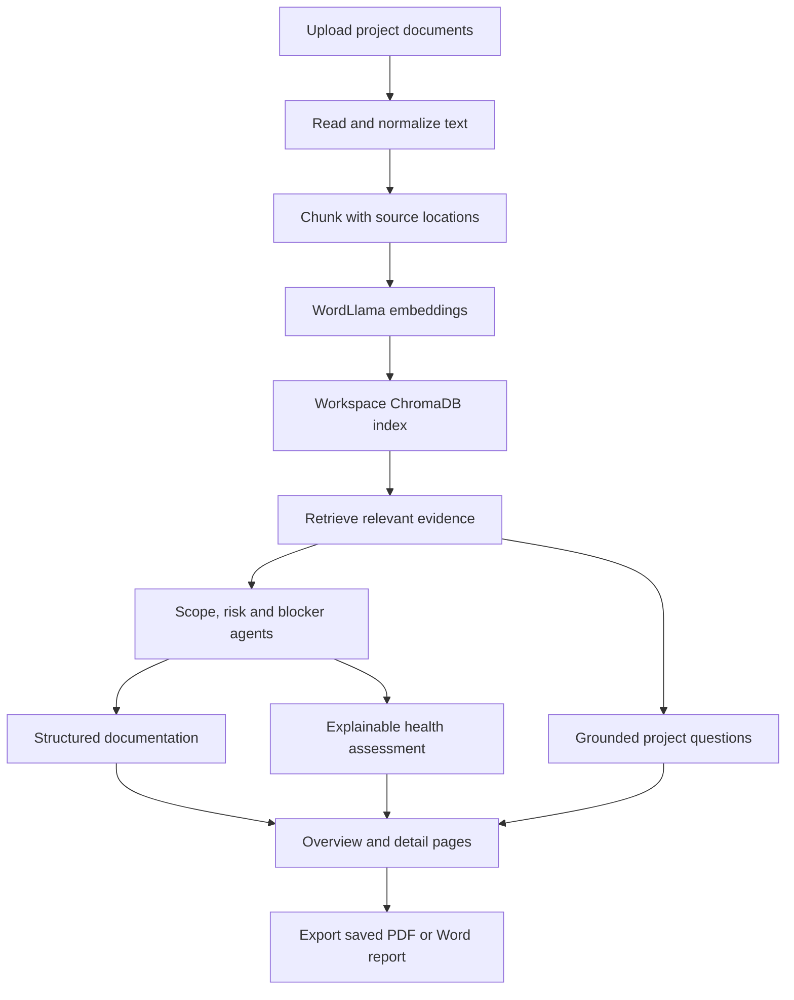
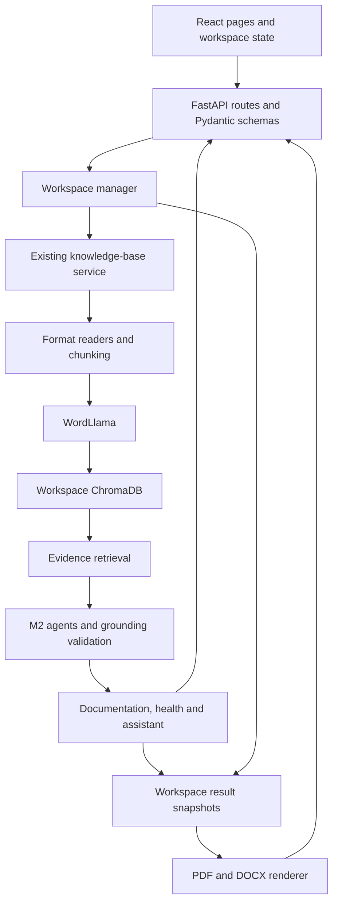

# AI Project Intelligence & Risk Advisor

**An evidence-grounded project review application built for the Infosys Springboard internship.**

AI Project Intelligence & Risk Advisor turns proposals, requirements, meeting notes, progress updates, and task lists into traceable project information. A reviewer can upload documents, inspect scope, risks and blockers, review an explainable health assessment, ask supported project questions, and download an evidence-backed report.

The final application combines Milestones 1–4 in one React and FastAPI project. It uses WordLlama embeddings and ChromaDB to retrieve relevant source passages. Its default analysis provider uses deterministic extraction rules: **no paid API key or live external language model is required for local analysis**. Model files and dependencies must still be available on the machine.

This README describes the current source implementation. Historical milestone documents remain unchanged and may describe earlier navigation, manual execution, or release status. For current setup and behavior, start here. Recorded verification results and outstanding checks are separated in [Testing and verification](#p-testing-and-verification).

## Contents

- [A. Introduction](#a-introduction)
- [B. Problem statement](#b-problem-statement)
- [C. Objectives](#c-objectives)
- [D. How the project works](#d-how-the-project-works)
- [E. Technology stack](#e-technology-stack)
- [F. Core features](#f-core-features)
- [G. Risk Priority Matrix](#g-risk-priority-matrix)
- [H. Milestones 1–4](#h-milestones-14)
- [I. System architecture](#i-system-architecture)
- [J. Folder structure](#j-folder-structure)
- [K. Windows installation and startup](#k-windows-installation-and-startup)
- [L. Environment configuration](#l-environment-configuration)
- [M. Using the application](#m-using-the-application)
- [N. Sample dataset](#n-sample-dataset)
- [O. API reference](#o-api-reference)
- [P. Testing and verification](#p-testing-and-verification)
- [Q. Limitations and responsible use](#q-limitations-and-responsible-use)
- [R. Troubleshooting](#r-troubleshooting)
- [S. Conclusion](#s-conclusion)

## A. Introduction

The application helps students, project reviewers, mentors, and delivery teams understand what their project documents actually establish. Its central rule is that important findings must point back to retrieved evidence. Owners, dates, ratings, and commitments remain **Not stated** when the available evidence does not establish them.

The interface has three working areas alongside Overview:

- **Sources:** upload and inspect documents.
- **Project Analysis:** Scope & Deliverables, Risk & Delivery, and Blockers & Actions.
- **Project Intelligence:** Documentation Studio, Project Health, and Project Assistant.

Overview brings their results together. Separate workspaces keep different projects' documents, vectors, results, and conversations apart.

## B. Problem statement

Project information is often scattered across proposals, meeting minutes, spreadsheets, requirements, and sprint updates. Finding an unresolved dependency or checking who owns an action requires reading several documents. Different documents may omit details or disagree.

This project provides one document-processing and retrieval foundation, then organizes supported information into structured views. It reduces the effort of locating relevant evidence and makes uncertainty visible. It does not independently verify a project's real-world condition or replace a project manager's judgment.

## C. Objectives

- Ingest readable PDF, DOCX, CSV, and TXT documents.
- Build a persistent knowledge base for retrieval-augmented generation, or **RAG**: retrieving source evidence before preparing an answer or analysis.
- Extract project goals, deliverables, milestones, timelines, and responsibilities.
- Identify documented risks, dependency gaps, delivery challenges, blockers, and action items.
- Prepare user-story drafts, a risk register, and structured action lists from explicit requirements and findings.
- Calculate an explainable evidence-based project-health assessment.
- Answer supported project questions with source quotations and references.
- Present concise project insights and an interactive risk matrix.
- Support incremental uploads, isolated project workspaces, and PDF/Word report export.

## D. How the project works



1. **Upload:** the browser sends files to FastAPI using multipart requests, scoped to the selected workspace.
2. **Read and normalize:** PDF pages, DOCX paragraphs/table rows, CSV rows, and TXT sections become readable source units. Unicode and whitespace normalization make their text consistent.
3. **Chunk:** each source unit is split into up to **180 words**, with **30 words of overlap**. Chunks do not cross source-unit boundaries.
4. **Embed:** WordLlama `l2_supercat` creates normalized **256-dimensional** vectors. An embedding represents text for similarity search; it is not a chat model.
5. **Store and retrieve:** ChromaDB persists vectors, passage text, and source metadata. Cosine similarity retrieves relevant passages; the configured minimum similarity is **0.16**.
6. **Analyze:** the agents select and validate supported source statements. Structured results retain quotations, evidence IDs, dates, and uncertainty.
7. **Prepare insights:** after successful indexing and provider readiness, frontend coordination runs the existing analysis and intelligence services. Results appear in Overview and their detail pages.
8. **Export:** the backend renders saved results and evidence into a report. Export does not generate new facts or recalculate scores.

The frontend uses relative `/api` requests. During development, Vite proxies those requests to FastAPI on port 8000. Retrieved passages and analysis findings remain distinct: a similar passage is candidate evidence, not automatically a verified answer.

## E. Technology stack

| Technology | Where it is used | Purpose |
| --- | --- | --- |
| React 19 | Frontend | Component-based pages, controls, and state |
| TypeScript | Frontend | Typed API contracts and UI models |
| React Router | Frontend | Navigation between existing pages |
| Vite 6 | Frontend tooling | Development server, API proxy, production build |
| Tailwind CSS 4 and custom CSS | Frontend | Layout, design tokens, themes, responsive presentation |
| Lucide React | Frontend | Consistent interface icons |
| Python | Backend | Processing, analysis, scoring, persistence, export |
| FastAPI and Uvicorn | Backend HTTP service | Validated API routes and application server |
| Pydantic | Backend schemas | Request validation and structured output models |
| WordLlama `0.4.0.post1` | Retrieval | `l2_supercat` 256-dimensional embeddings |
| ChromaDB | Workspace storage | Persistent vector indexing and semantic retrieval |
| NumPy | Embedding adapter | Vector validation and normalization |
| pypdf | Document processing | Extract text from readable PDF pages |
| python-docx | Processing and export | Read DOCX paragraphs/tables and generate Word reports |
| ReportLab | Export | Generate PDF reports with bundled fonts |
| HTTPX | Provider adapter and tests | HTTP requests and API/transport validation |
| python-multipart | Upload endpoint | Receive multipart file uploads |
| Pytest | Python tests | Unit, integration, regression, and live-service checks |
| Vitest, Testing Library, jsdom | Frontend tests | Component, state, interaction, and DOM checks |
| Git / GitHub | Source-management workflow | Version control and repository collaboration; neither is a runtime service required to run the extracted source |

**Default provider — `extractive`:** conservative English-language rules select explicit source statements from real retrieved evidence. This is useful without a live LLM, but it is not unrestricted generative reasoning.

**Optional provider — `openai_compatible`:** a configurable chat-completions adapter sends selected passages to a chosen compatible endpoint. It requires suitable endpoint/model configuration and credentials when the provider requires them. Returned candidate findings must still pass the application's grounding checks. It does not bypass the evidence boundary or replace WordLlama/ChromaDB.

The final runtime does not use Streamlit, TensorFlow, or a second RAG framework. Historical UI descriptions are not statements about the current frontend.

## F. Core features

The examples below describe supported use, not additional claims about the uploaded project.

| Feature | What it does and how | Practical example |
| --- | --- | --- |
| **1. Document upload and processing** | Accepts PDF, DOCX, CSV, and TXT; records per-file indexed/error state and source locations. Limit: 20 files per batch, 10 MiB per file. | Upload a proposal, minutes, and task list together; correct and reselect an unreadable file if it fails. |
| **2. RAG and semantic retrieval** | Searches persistent WordLlama/ChromaDB evidence before analysis. The retrieval API remains available even though Knowledge Base and Evidence Search are no longer sidebar pages. | Retrieve a passage mentioning a blocked integration task and inspect its filename and location. |
| **3. Scope & Deliverables** | Organizes exact evidence under goals, deliverables, milestones, timelines, and responsibilities. | Review which deliverables a proposal explicitly promises. |
| **4. Risk & Delivery** | Finds schedule risks, dependency gaps, delivery challenges, and stated delivery outlook. It does not predict an unstated delivery date or probability. | See that a review depends on an approval while the revised delivery date remains unknown. |
| **5. Blockers & Actions** | Extracts pending decisions, unresolved issues, and actions with supported owners, dates, and status. | Display an access-restoration action with its documented owner; leave an unassigned action as Not stated. |
| **6. Documentation Studio** | Builds structured user stories, risk entries, and action lists by composing existing agents and explicit requirement extraction. Tabs, filters, focus editing, and regeneration support review. | Turn an explicit “As a reviewer…” requirement into a story draft with its source reference. |
| **7. Project Health** | Applies the fixed deterministic model to scope clarity, timeline risk, and blocker health. Shows the calculation and supporting evidence. | Open “Why this score?” to understand which documented concerns affected the result. |
| **8. Project Assistant** | Prepares a default briefing and supports bounded conversational follow-ups using retrieved quotations. History supplies question context, not project facts. | Ask “Which tasks are blocked?” and review cited statements; an unsupported question receives insufficient information. |
| **9. Project Insights dashboard** | Overview shows the risk matrix first, followed by workflow/export and concise health, risk, action, and scope summaries. Detail links retain longer explanations elsewhere. | Scan project concerns, then open Risk & Delivery for full evidence. |
| **10. Risk Priority Matrix** | Positions risks using explicit probability and impact, groups documented IDs, and retains unpositioned records and additional observations. | Inspect R-01 once in the identified-risk view while accessing every supporting passage. |
| **11. Automatic preparation and refresh** | Shared resources wait for indexing/provider readiness, cache results, invalidate old source versions, and reject obsolete responses. Refresh/Retry remain available. | Add new evidence and see current analysis prepare without clicking Generate on each page. |
| **12. Incremental upload** | New documents append to the existing workspace index. Session content checks skip identical queued/already-indexed content within that session. | Add a new sprint update without removing the original proposal. |
| **13. Workspaces and history** | A project switcher creates or opens separate backend stores and restores saved results/view state. | Keep two project datasets separate and return to the previous project's analysis. |
| **14. PDF and Word export** | Overview downloads available saved results, scores, warnings, and source references through the workspace export API. | Download an editable Word report after reviewing the current analysis. |
| **15. Themes and responsive UI** | Navy/blue/amber styling, light/dark themes, responsive panels, keyboard controls, and reduced-motion CSS support different screens. | Switch theme or select a risk with the keyboard; on narrow screens its records panel is below the graph. |
| **16. Notifications and workflow** | Real operation events produce dismissible notices lasting about 2.5 seconds, with hover/focus pause and a small stack limit. Overview alone shows Reading documents → Analyzing project → Preparing insights → Ready. | An upload failure stays actionable in the page even after its toast disappears. |

### Automatic execution and freshness

Automatic work runs for the active workspace when sources and the provider are ready. M2 analysis completes before default intelligence preparation. Documentation and health share cached default results across Overview and their pages. The briefing also uses internal “Are we on track?” and “What is blocking the project?” requests; these are not inserted as user chat messages.

Source changes invalidate earlier results. Useful prior content can remain visible with stale/error labels during refresh. Request/version guards prevent older responses from becoming current; failed work has explicit retry rather than an endless retry loop. Reopening a route should use valid cached or saved results.

This coordination reuses the existing service path. **M3 services may run M2 agents internally**; it is not a promise that every backend analysis computation is reused. Automatic execution is driven by the running frontend, not a background scheduler after the application is closed. See the regression limitations in section P.

### Health model: `evidence-health-v1`

| Dimension | Calculation | Meaning |
| --- | --- | --- |
| Scope clarity | Five categories: goals, deliverables, milestones, timelines, responsibilities. Each earns 20 points when established, 10 when unclear, or 0 when missing. No scope evidence makes the dimension unavailable. | Higher is better. |
| Timeline risk | Unique unresolved schedule-risk/delivery-challenge statements add penalties: `critical` 45, `high` 30, `medium` 20, `low` 10; otherwise 25. Sum capped at 100. | **Higher means more risk.** Health contribution is `100 − timeline risk`. |
| Blocker health | `max(0, 100 − 20 × unique unresolved-issue statements)` | Higher is better. The count is retrieved statements, not independently verified incidents. |

```text
Overall = round half up(
    0.40 × scope clarity
  + 0.35 × (100 − timeline risk)
  + 0.25 × blocker health
)
```

All three dimensions must be assessable; otherwise the overall score is unavailable. Weights are not redistributed. An explicit supported zero-concern statement is required for an assessed zero risk/blocker count. Contradictory zero and concern statements make that dimension unavailable.

Interpretations are **75–100: Fewer documented concerns**, **45–74: Review needed**, and **0–44: Needs attention**. The model deduplicates identical quotations, not all differently worded descriptions of one issue. Matrix severity presentation does not recalculate this model; the penalty table above uses the scoring service's actual labels. A health score is neither a completion percentage nor a delivery probability. Full methodology: [docs/health-scoring.md](docs/health-scoring.md).

## G. Risk Priority Matrix

The matrix uses the generated documentation risk register and its evidence. It does not assign ratings from a title, a health score, or the visual position of another risk.

- **Horizontal axis:** documented Probability/Likelihood.
- **Vertical axis:** documented Impact.
- **Severity:** separately documented Critical, High, Moderate, Low, or Not stated, with text labels, visual distinction, and filters. Severity is not calculated by multiplying axes.
- **Scale handling:** supported explicit qualitative/percentage values are recognized in structured fields and source sentences. Medium/Moderate share the displayed convention; different source scales are kept separate rather than silently converting words such as Likely or Major into High or a percentage.
- **Grouping:** entries carrying the same unambiguous documented Risk ID become one identified risk, retaining supporting records and evidence. Entries without a clear ID remain additional evidence-only observations. An internal generated entry ID is not a documented Risk ID.
- **Conflicts:** contradictory documented fields remain unresolved and available for inspection. The UI does not choose the more severe value merely to position a point.
- **Missing values:** one-axis or unpositioned evidence areas retain risks whose probability or impact is absent. Missing severity stays Not stated. No coordinate is invented to fill the chart.
- **Overlaps:** screen-space offsets and label placement improve readability while preserving the original values. A displayed offset is not another assessment.

### Inspecting a risk

Hover or keyboard-focus a positioned point for a compact **ID, short title, and severity** hint. The hint is placed outside the chart area and hidden if no safe space is available. Click or tap to open full details and supporting evidence in **Positioned risk records**. Selection highlights the point and its record; Close/Escape supports returning to the invoking control.

On touch devices the large hover popup is suppressed. The same records panel is used, below the graph on narrow layouts. Changing filters or leaving a point dismisses its hint. Unpositioned/evidence cards retain their existing detail interaction.

**Counts need context:** nine documented IDs can produce more than nine raw extracted observations. The matrix's identified-risk counts describe grouped IDs; additional observations are shown separately. Neither is a verified count of all real-world incidents. The included six-file demo produced **9 identified risks and 10 additional observations from 19 raw risk entries** in the recorded local run—not 19 uniquely named risks.

## H. Milestones 1–4

| Milestone | Main objective | Implemented scope |
| --- | --- | --- |
| **M1 — RAG foundation** | Make project documents retrievable | PDF/DOCX/CSV/TXT ingestion, normalization, fixed chunking, WordLlama embeddings, persistent ChromaDB indexing, source-aware retrieval |
| **M2 — Project analysis** | Extract grounded project information | Scope & Deliverables, Risk & Delivery, Blockers & Actions; structured outputs, evidence checks, uncertainty, cross-format validation |
| **M3 — Project intelligence** | Build useful derived views | Documentation generation, explainable health dimensions, grounded conversational assistant, accuracy/relevance tests |
| **M4 — Final project presentation** | Consolidate and demonstrate the product | Project Insights dashboard, incremental uploads, end-to-end validation work, technical documentation, project report, final demo instructions |

Workspaces, automatic coordination, report export, canonical risk grouping, theme polish, and refined point interactions are final product extensions/refinements. They are not retroactively presented as original M1 requirements. Historical M1/M2 records—including earlier UI descriptions—remain historical. A milestone implementation table is not a claim that every final verification check passed.

Supporting records: [M1](docs/milestone1.md), [M2](docs/milestone2.md), [M3](docs/milestone3.md), [M4](docs/milestone4.md), and [final project report](docs/final-project-report.md).

## I. System architecture



**Frontend:** pages and shared contexts coordinate requests, display source versions, preserve session state, and render evidence. The current routes are:

| Sidebar group | Page | Route |
| --- | --- | --- |
| Workspace | Overview | `/dashboard` |
| Sources | Documents | `/documents` |
| Project Analysis | Scope & Deliverables | `/scope` |
| Project Analysis | Risk & Delivery | `/risks` |
| Project Analysis | Blockers & Actions | `/blockers` |
| Project Intelligence | Documentation Studio | `/documentation` |
| Project Intelligence | Project Health | `/project-health` |
| Project Intelligence | Project Assistant | `/assistant` |

Unknown routes redirect to Overview. Knowledge Base and Evidence Search are not current navigation destinations; their underlying summary/retrieval APIs remain part of the application.

**Backend:** `app/api/` validates requests and calls processing, agents, intelligence, workspace, and export services. Grounding validates retrieved evidence IDs and quotation/category support. Unknown structured fields are nullable and rendered as Not stated.

**Retrieval:** agents use bounded targeted queries against the same knowledge base, not a second index. Each M2 retrieval is limited to 12 unique passages and 14,000 characters; limited coverage is reported. Local provider output is also bounded. These limits make results reviewable but do not guarantee exhaustive extraction from every document.

**Persistence:** `DATA_DIR` defaults to `backend/data/`. The original index stays in the `legacy` workspace, displayed initially as Current project. New workspaces use separate `workspaces/<id>/` directories beneath that root. The registry is `workspaces.json`; each store has a document manifest, Chroma data, and a `workspace-state.json` result/view snapshot. IDs route requests through `X-Workspace-ID`.

Documents and results persist across backend restarts. Completed results include source versions and generation timestamps; late outdated operations are not committed as current. Saved view state restores relevant queries, filters, and conversation references. This is saved working history, not an immutable audit log of every run.

Original uploaded binaries are processed in memory; the service persists extracted text, vectors, and metadata. Keep original files separately. Browser session storage holds the selected workspace ID and theme preference, not source documents or evidence. In-flight uploads do not resume after a reload.

## J. Folder structure

```text
AI-Project-Intelligence/
├── backend/
│   ├── app/
│   │   ├── api/                  # FastAPI routes and request/response models
│   │   ├── agents/               # M2 agents, documentation, grounding, ratings
│   │   ├── core/                 # Fixed settings and data-root configuration
│   │   ├── exports/              # Saved-result projection, PDF/DOCX rendering
│   │   ├── intelligence/         # M3 schemas and shared evidence composition
│   │   ├── llm/                  # Extractive and configurable provider adapter
│   │   ├── services/             # Ingestion, embeddings, retrieval, health, chat
│   │   ├── workspaces/           # Registry, isolated stores, result/view state
│   │   └── main.py
│   ├── tests/
│   ├── requirements.txt
│   ├── requirements-dev.txt
│   ├── requirements-lock.txt
│   └── requirements-windows-py311.txt
├── frontend/
│   ├── src/
│   │   ├── components/
│   │   ├── dashboard/            # Risk matrix, grouping, summaries, interactions
│   │   ├── experience/           # Automatic analysis, workflow, export controls
│   │   ├── intelligence/         # Shared intelligence state and typed results
│   │   ├── pages/
│   │   ├── presentation/         # Branding, themes, health visuals and styles
│   │   ├── workspaces/
│   │   ├── App.tsx
│   │   └── SessionContext.tsx
│   ├── package.json
│   ├── package-lock.json
│   └── vite.config.ts
├── data/sample_documents/       # Earlier source fixtures, not the runtime DB
├── sample_documents/            # Recommended six-document final demo + README
├── samples/                     # Earlier four-document Atlas Portal fixtures
├── validation_samples/          # Equivalent agent content across four formats
├── scripts/                     # Sample creation and live-service smoke helpers
├── tests/                       # Foundation compatibility and live tests
├── rag_pipeline/                # Compatibility adapters used by foundation tests
├── docs/                        # Architecture, milestone records, verification
├── .env.example
├── .gitignore
├── LICENSE
├── pytest.ini
├── PROJECT_FILES.md
└── README.md
```

This is a main-folder overview, not an exhaustive file manifest. `rag_pipeline/` supports earlier tests; the live application uses `backend/app/`. Runtime databases, virtual environments, `node_modules`, caches, and build output are not source deliverables. Do not confuse root `data/sample_documents/` with the default runtime `backend/data/`.

## K. Windows installation and startup

### 1. Prerequisites and project folder

Use **64-bit Python 3.11** and **Node.js 22**. The included Vite version accepts Node `^18.0.0`, `^20.0.0`, or `>=22.0.0`; Node 22 is a compatible choice for these instructions. Use PowerShell and optionally VS Code.

Do not accidentally create the environment with **32-bit Python 3.10**: native ChromaDB dependencies may not have compatible wheels. A requirements file cannot change interpreter architecture.

Extract the complete project and open the folder containing `backend`, `frontend`, and this README. In PowerShell, replace this example path with the actual extracted folder:

```powershell
Set-Location 'C:\Users\Manohar.B\OneDrive\Desktop\AI-Project-Intelligence'
Test-Path .\backend\app\main.py
Test-Path .\frontend\package.json
py -0p
py -3.11 -c "import sys, struct; print(sys.version); print(struct.calcsize('P') * 8)"
node --version
npm.cmd --version
```

Both `Test-Path` commands must return `True`; the architecture check must print `64`. A folder containing only `.venv` is not the project source.

### 2. Create and activate the Python environment

For a fresh installation:

```powershell
py -3.11 -m venv .venv
.\.venv\Scripts\Activate.ps1
python -c "import sys, struct; print(sys.executable); print(struct.calcsize('P') * 8)"
```

If activation is blocked, use the process-only execution-policy command in section R, or use the explicit `.venv` interpreter commands below without activation. Do not overwrite a working environment just to rerun setup.

### 3. Install backend dependencies

From the project root:

```powershell
.\.venv\Scripts\python.exe -m pip install --upgrade pip
.\.venv\Scripts\python.exe -m pip install -r .\backend\requirements-windows-py311.txt
```

The Windows file pins the resolved **CPython 3.11 / Windows x64** dependency set, including test dependencies. It is the preferred path here. `requirements.txt` describes runtime dependency ranges, and `requirements-dev.txt` adds development dependencies for other environments. `requirements-lock.txt` is a Linux/Python 3.12 reference and must not be used as the Windows installer.

The repository records successful Windows-target dependency resolution. That is not the same as a verified native Windows runtime test; see section P.

### 4. Install frontend dependencies

```powershell
Set-Location .\frontend
npm.cmd ci
Set-Location ..
```

Use the committed lockfile with `npm.cmd ci`. Running `npm.cmd` avoids PowerShell's `npm.ps1` execution-policy issue. A global Vite installation is not needed.

### 5. Terminal 1 — start the backend

From the project root:

```powershell
$env:LLM_PROVIDER = 'extractive'
.\.venv\Scripts\python.exe -m uvicorn app.main:app --app-dir backend --host 127.0.0.1 --port 8000
```

Wait for application startup to complete. Initial WordLlama loading may take time and may need model downloads. Keep this terminal running.

### 6. Terminal 2 — start the frontend

Open a second PowerShell terminal at the same project root:

```powershell
Set-Location .\frontend
npm.cmd run dev
```

Keep this terminal running too. Open:

- Application: **http://127.0.0.1:5173/**
- API documentation: **http://127.0.0.1:8000/docs**
- Backend readiness: **http://127.0.0.1:8000/api/health**

The readiness endpoint describes backend/model availability, not the project's health score. Stop each server with `Ctrl+C` in its own terminal when finished.

### Keep existing project data

When replacing source files, preserve the existing runtime data directory. A newly extracted source folder without that data starts empty. Set `DATA_DIR` to the existing absolute path before backend startup if needed; do not copy over or reset an existing database to install the UI.

## L. Environment configuration

**`.env.example` is documentation; the application does not automatically load a `.env` file.** Set variables in the backend terminal before starting Uvicorn. Restart the backend after changing provider settings.

| Variable | Meaning | Default / requirement |
| --- | --- | --- |
| `DATA_DIR` | Absolute root for document metadata, vectors, workspace registry and saved state | Defaults to `backend/data/` |
| `LLM_PROVIDER` | Provider selection | `extractive`; optional `openai_compatible` |
| `LLM_BASE_URL` | Compatible API base URL; adapter appends `/chat/completions` | Required for configured provider |
| `LLM_MODEL` | Model name accepted by that endpoint | Required for configured provider |
| `LLM_API_KEY` | Optional bearer credential, according to endpoint requirements | Empty by default |

Default local analysis:

```powershell
$env:LLM_PROVIDER = 'extractive'
# Optional: point to an existing persistent data directory.
# $env:DATA_DIR = 'C:\ProjectData\AI-Project-Intelligence'
```

Optional provider configuration, using placeholders:

```powershell
$env:LLM_PROVIDER = 'openai_compatible'
$env:LLM_BASE_URL = 'https://your-provider.example/v1'
$env:LLM_MODEL = 'your-model-name'
$env:LLM_API_KEY = 'your-private-api-key'
```

Remote endpoints require HTTPS; HTTP is allowed for loopback local model servers. Syntactically valid configuration is not proof of endpoint connectivity: connectivity is checked when analysis runs. Provider failures are reported rather than silently replaced with local results.

Never commit real keys. The configured provider receives selected project evidence, so consider document sensitivity and the provider's data handling before enabling it. The default extraction provider makes no LLM API call; installing dependencies or obtaining WordLlama files can still require internet access.

## M. Using the application

1. **Start both services** and open the frontend URL.
2. **Choose a workspace** using the top project switcher. Create a new workspace for a separate project; a new workspace has an empty knowledge base. Existing data remains in its original workspace.
3. **Open Documents** or use Add Documents. Select or drag in supported files. Review filenames, sizes, and any validation messages, then upload.
4. **Wait for indexing and automatic analysis.** Inspect per-file status if some files fail. Overview's compact workflow reflects actual progress, and unavailable/failed stages must be resolved rather than treated as Ready.
5. **Review the Risk Priority Matrix.** Check identified risks and additional observations separately. Filter severity, inspect a point, and review missing-coordinate records.
6. **Review health, key risks, actions, and scope.** Use detail links for the underlying analysis. Read “Why this score?” before interpreting a health value.
7. **Open Documentation Studio.** Review User Stories, Risk Register, and Action Items. Missing fields stay Not stated; optional focus editing/regeneration supports a narrower review.
8. **Open Project Assistant.** Read the automatic briefing, then optionally ask a supported question such as “Are we on track?” or “Which tasks are blocked?” A briefing is not a fabricated conversation.
9. **Inspect source evidence.** Expand references to check the filename, extraction location, evidence ID, and quotation. Similarity is a retrieval measure, not factual confidence.
10. **Export from Overview.** Use Export / Download immediately beneath the matrix; choose PDF or Microsoft Word. The action waits for current processing requests to finish and requires saved analysis.
11. **Switch projects.** Open a previous workspace to restore its saved documents and results. Cached workspaces can restore quickly; first access may require loading a backend snapshot. Upload additional content only into the intended workspace.

Reports include available project summary, scope, risks/delivery, blockers/actions, structured documentation, health calculations, automatic briefing insights, and an evidence appendix. Missing sections and stale results are labeled. Personal follow-up chat is not silently included: the insights section selects the existing default briefing questions.

## N. Sample dataset

### Recommended final demonstration

Upload these **six files together** from `sample_documents/` into a fresh workspace:

| File | Contents |
| --- | --- |
| `AI_Project_Proposal.pdf` | Project purpose, scope, deliverables, milestones and plan |
| `AI_Project_SRS.docx` | Requirements and explicit story information |
| `AI_Project_Meeting_Notes.docx` | Decisions, blockers, owners and action items |
| `AI_Project_Sprint_Update.txt` | Progress, delivery outlook, dependencies and named risks |
| `AI_Project_Task_List.csv` | Consistent task IDs, states, owners, dates and dependencies |
| `AI_Project_Risk_Register.docx` | Nine named risks with explicit probability, impact, severity, owner, date and status |

The accompanying `sample_documents/README.md` is a guide; do not upload it as a seventh document. Samples are **not automatically seeded** into a workspace.

These files describe one **fictional** AI Project Intelligence & Risk Advisor demonstration scenario, `AIPI-DEMO-26`, with a snapshot date of **2026-10-07**. Their tasks, people, deadlines, risks, and blockers are sample evidence, not historical internship facts, actual defects, or real verification results.

The named risks R-01 through R-09 explicitly cover **2 Critical, 3 High, 3 Moderate, and 1 Low** severity records. The scenario includes blocked validation work and pending decisions, so the health result should not be assumed healthy merely because the software runs. The recorded six-document check indexed 126 passages and returned health 40; these are observed outputs for that source/configuration, not dashboard constants or guarantees for changed inputs.

### Other preserved fixtures

| Folder | Purpose |
| --- | --- |
| `samples/` | Earlier four-file fictional Atlas Portal demo used by live regression scripts; its counts differ from the recommended final dataset |
| `validation_samples/` | Equivalent agent project content in PDF, DOCX, CSV, and TXT for cross-format testing |
| `data/sample_documents/` | Earlier document-processing fixtures, including requirements and risk-report material |

Use separate workspaces for unrelated fixture projects. Combining sample projects in one workspace makes their documents part of the same evidence pool.

## O. API reference

FastAPI exposes interactive schemas at `/docs`. Existing scoped calls use **`X-Workspace-ID`**; omitting it selects the compatibility `legacy` workspace. Workspace IDs are routing context, not authentication credentials.

| Method | Endpoint | Purpose |
| --- | --- | --- |
| GET | `/api/health` | Backend embedding/vector-store readiness |
| GET | `/api/documents` | Selected workspace's document metadata and status |
| POST | `/api/documents/upload` | Multipart upload with repeated `files` fields |
| GET | `/api/knowledge-base` | Document/indexed/passage counts and retrieval readiness |
| POST | `/api/retrieval/query` | Source passage retrieval: `query`, optional `top_k` (1–10) |
| GET | `/api/agents/status` | Provider mode, availability and agent information |
| POST | `/api/agents/scope` | Scope & Deliverables analysis |
| POST | `/api/agents/risk` | Risk & Delivery analysis |
| POST | `/api/agents/blockers` | Blockers & Actions analysis |
| POST | `/api/documentation/generate` | User stories, risk register and action items |
| POST | `/api/project-health/assess` | Deterministic health assessment and explanations |
| POST | `/api/assistant/query` | Grounded response to `question` and optional `history` |
| GET | `/api/workspaces` | List existing workspaces |
| POST | `/api/workspaces` | Create a fresh workspace using `name` |
| GET | `/api/workspaces/{workspace_id}/state` | Saved source-version/result/view snapshot |
| PUT | `/api/workspaces/{workspace_id}/view` | Save supported frontend view state |
| GET | `/api/workspaces/{workspace_id}/export?format=pdf` | Download saved results as PDF |
| GET | `/api/workspaces/{workspace_id}/export?format=docx` | Download saved results as Word |

Agent, documentation, and health calls accept a `query` focus; consult `/docs` for exact field limits. For example, from PowerShell with the backend running:

```powershell
$headers = @{ 'X-Workspace-ID' = 'legacy' }
$body = @{ query = 'Review the uploaded project documents.' } | ConvertTo-Json
Invoke-RestMethod -Method Post -Uri 'http://127.0.0.1:8000/api/agents/risk' -Headers $headers -ContentType 'application/json' -Body $body
```

Replace `legacy` with the selected workspace's real ID when needed. The UI route `/risks` is plural; the API route `/api/agents/risk` is singular.

Relevant failures include validation errors (`422`), unknown workspaces (`404`), incompatible workspace/export state (`409`), unavailable provider (`503`), and rejected provider/grounding output (`502`). Upload responses contain per-file results: an HTTP-success response can still include failed files. There are no document-delete, reindex, or original-file-preview APIs in this implementation.

## P. Testing and verification

### Commands

Run Python commands from the project root using the installed environment. The complete suite includes live tests that launch servers on ports 8000/5173: install frontend dependencies first and stop manually running servers before those tests.

```powershell
# Complete Python suite: backend tests plus root foundation/live tests.
.\.venv\Scripts\python.exe -m pytest -q

# Backend folder only, when a narrower check is needed.
.\.venv\Scripts\python.exe -m pytest backend\tests -q

# Focused integration and final feature checks.
.\.venv\Scripts\python.exe -m pytest backend\tests\test_integration.py backend\tests\test_m3_integration.py backend\tests\test_m4_incremental.py backend\tests\test_workspaces.py backend\tests\test_exports.py backend\tests\test_recommended_demo.py -q

# Actual backend + Vite-proxy live checks; ports must be free.
.\.venv\Scripts\python.exe -m pytest tests\test_live_application.py tests\test_m3_live_application.py -q
```

The live helpers use temporary data directories, not the normal project workspace. The M2 smoke helper also writes its verification JSON under `docs/`; review generated report changes separately from historical records after a local run.

Frontend tests and build:

```powershell
Set-Location .\frontend
npm.cmd test
npm.cmd run build

# Focused risk grouping, evidence and interaction checks.
npm.cmd test -- src/dashboard/RiskPriorityMatrix.test.tsx src/dashboard/canonicalRisks.test.tsx src/dashboard/riskEvidenceCoverage.test.tsx src/dashboard/riskPointInteraction.test.tsx --maxWorkers=1 --testTimeout=20000
Set-Location ..
```

Python coverage includes extraction, chunking, real embedding/vector integration, grounding, unknown fields, health calculations, assistant relevance, cross-format behavior, incremental upload, workspace isolation, and report rendering. Frontend tests cover state/interaction behavior, automatic resources, workspace restoration, risk grouping and geometry, filters, notifications, and export controls. jsdom/geometry tests are not substitutes for rendered browser checks.

### Latest recorded results, not a fresh test run for this README

| Record | Actual reported result | Qualification |
| --- | --- | --- |
| [Visual correction verification](docs/visual-correction-verification.md) | Root Python suite: **317 passed**, one Starlette/HTTPX deprecation warning, 90.65 seconds | Precedes the final point-interaction patch; not 317 backend-folder-only tests |
| Same report | Initial full frontend run: **167 of 170 cases passed; 3 failed** | Not a clean frontend-suite pass; later follow-ups were inconsistent |
| Same report | Six-file ingestion/API check: **6 indexed documents, 126 passages, 19 raw risk entries, health 40** | Canonical presentation retained **9 identified risks + 10 observations** |
| [Point-interaction verification](docs/risk-point-interaction-verification.md) | **41 focused cases reported passed, 0 failed**: matrix 18, grouping/labels 13, evidence 4, interactions 6 | One-worker run with a 20-second per-test limit; worker did not terminate cleanly and was stopped after results |
| Same final interaction report | Frontend production build **passed**; Vite phase 8.82 seconds | TypeScript/Vite build success does not prove browser layout correctness |

Do not add these counts together: they cover different runs and overlapping tests. No new application test execution is claimed by this README update.

The earlier full frontend failures concerned chat quotation visibility, an ambiguous insufficient-evidence assertion, and workspace hydration request count. They were outside the final interaction patch and are **not claimed resolved**. Follow-up instability and the runner's non-terminating behavior remain documented limitations.

**Still unverified for the latest presentation patch:** a clean full frontend regression run, new full backend rerun after that patch, rendered desktop/mobile and both-theme inspection, actual touch/keyboard browser walkthrough, and reduced-motion visual inspection. Local Chromium failed at launch; the connected preview was blocked. Native Windows execution and a live external LLM call are also not established by these final reports. Windows-target package resolution is recorded in `docs/python311-windows-resolution.json`.

Before a mentor demo, locally check the six-file upload, all nine risk IDs and additional observations, filters, inline evidence, project switching, notification dismissal, and both PDF/Word downloads. Recorded automated export coverage does not substitute for checking a browser download on the intended Windows machine.

## Q. Limitations and responsible use

- **Evidence quality governs results.** Missing information is not proof that no risk, blocker, or owner exists. No evidence found must never be interpreted as an all-clear.
- **Retrieval is bounded.** A result may be partial, and the local English extraction rules can miss indirect wording. Narrow the focus and inspect sources when coverage matters.
- **Grounding is not external verification.** Exact quotations can themselves be outdated, incomplete, or incorrect. Review them before making commitments.
- **Risk and health concepts differ.** The matrix uses explicit risk ratings. Health uses its fixed statement-based model. Neither predicts delivery or ranks undocumented priorities.
- **Uploads append evidence.** New content does not replace contradictory older statements automatically. Session duplicate checks are not a permanent cross-session deduplication guarantee.
- **Input limits apply.** No OCR is included; scanned PDFs need text recognition before upload. Encrypted PDFs are rejected. DOCX extraction covers body paragraphs/tables; expanded DOCX content is limited to 50 MiB. CSV/TXT must be UTF-8; CSV needs unique nonempty headers and matching column counts.
- **Local deployment model.** Workspaces partition application data, but there is no user authentication or authorization boundary. Anyone with backend access can access registered workspaces. This is a local single-user/single-process application, not a secured multi-tenant service. Keep its default loopback binding.
- **Runtime data needs care.** The data root contains sensitive extracted content and results. Preserve it when updating source; keep independent backups appropriate to the project. Original files are not retained as downloadable originals.
- **Source-version checks have limits.** They use indexed document identities and passage counts; out-of-band changes preserving those values may not be detected. Use the supported upload workflow.
- **Optional external processing has costs/privacy implications.** It may need credentials and internet access. First-time WordLlama model loading may also require internet; verify cached availability before an offline demo.
- **Saved working state is not a durable job queue.** Reloading interrupts frontend work; completed backend results can be restored, but unfinished uploads are not resumed automatically.

## R. Troubleshooting

### `vite is not recognized`

Run from the frontend folder and install its local dependencies:

```powershell
Set-Location .\frontend
npm.cmd ci
npm.cmd run dev
```

If already in `frontend`, omit the first command. Do not install global Vite to work around a missing project installation.

### `ECONNREFUSED 127.0.0.1:8000`

The frontend proxy cannot reach the backend. Start Terminal 1 using section K, wait for startup, and open `http://127.0.0.1:8000/api/health`. Check the backend terminal for missing packages or model-loading errors. Vite expects backend port 8000.

### PowerShell blocks environment activation

Apply the policy only to the current terminal, then activate:

```powershell
Set-ExecutionPolicy -Scope Process -ExecutionPolicy Bypass
.\.venv\Scripts\Activate.ps1
```

Alternatively, skip activation and use `.\.venv\Scripts\python.exe` explicitly. No permanent system policy change is required.

### `ModuleNotFoundError: pip._internal`

From the project root, try repairing pip inside this environment:

```powershell
.\.venv\Scripts\python.exe -m ensurepip --upgrade
.\.venv\Scripts\python.exe -m pip install --upgrade pip
```

If the environment remains broken, stop its processes and create a fresh environment with verified 64-bit Python 3.11. Preserve or rename the old environment using an unused backup name first. Do not remove `backend/data`, a custom `DATA_DIR`, source files, or sample documents.

### ChromaDB installation fails or Python is 32-bit

```powershell
py -3.11 -c "import sys, struct; print(sys.executable); print(struct.calcsize('P') * 8)"
.\.venv\Scripts\python.exe -c "import sys, struct; print(sys.executable); print(struct.calcsize('P') * 8)"
```

Both should identify the intended interpreter; the architecture must be 64. Installing x64 Python does not convert an existing 32-bit virtual environment. Create the new environment with the correct interpreter and install the Windows-specific requirements. Do not use the Linux lockfile or remove required packages to force installation.

### Missing Python package

Confirm the server uses the project's `.venv` interpreter, then rerun:

```powershell
.\.venv\Scripts\python.exe -m pip install -r .\backend\requirements-windows-py311.txt
```

Use `python -m pip` through that explicit interpreter rather than a possibly unrelated global `pip`.

### Port 8000 or 5173 is already in use

Check listeners:

```powershell
Get-NetTCPConnection -LocalPort 8000,5173 -State Listen -ErrorAction SilentlyContinue
```

Stop your earlier server with `Ctrl+C` in its terminal. Do not terminate unrelated processes blindly. Live tests need both ports free. Keep the documented ports for normal use: changing the backend port without changing the frontend proxy causes connection failures. Check Vite's printed URL if it selected another port.

### Documents do not appear after upload

Confirm the active workspace and inspect Documents for per-file errors. Verify the supported extension, size, readable text, and UTF-8 CSV/TXT encoding. An upload response can contain partial failures. An identical file may have been skipped by the session duplicate check. Correct the file and select it again; use Refresh/Retry as appropriate.

If all earlier data disappeared after moving the source folder, check which `DATA_DIR` the backend uses. Point it to the existing data root before startup rather than deleting or recreating the workspace registry.

### Analysis stays unavailable

Check that at least one source is indexed, the backend is connected, and the provider is ready. For a local demo set `LLM_PROVIDER=extractive` and restart the backend. Optional provider errors require checking the URL/model/credentials; the application does not silently switch provider. Read the visible failure before retrying.

### Risks are visible but not positioned

Open their evidence. Probability and impact must be explicitly established for that risk; severity alone is not enough. Conflicting or missing fields remain unpositioned/partially positioned. Inspect additional observations separately from documented Risk IDs. Do not edit values merely to populate a graph. The recommended sample risk register contains explicit ratings for demonstration.

### PDF/Word export fails

Wait for indexing and analysis/intelligence requests to finish. At least one saved M2 analysis result is required. Ensure the selected workspace still exists and read the export error or backend log. Install the complete backend requirements so ReportLab/python-docx are available. Retry through Export / Download and check the browser's downloads permissions/location.

If a report labels a section outdated or unavailable, refresh/retry that analysis first. Export preserves that state; it does not invent missing sections or run a new assessment during download.

## S. Conclusion

AI Project Intelligence & Risk Advisor brings document ingestion, semantic retrieval, grounded analysis, structured documentation, explainable health, and project Q&A into one application. Its Overview and exports help reviewers move from scattered source files to a concise project review while retaining the evidence and uncertainty behind each conclusion.

The strongest demonstration is a complete traceable workflow: upload the recommended dataset into its own workspace, review automatically prepared insights, inspect the source of a risk or action, explain the health calculation, and export the available results. The value lies in making project evidence easier to understand—not in inventing certainty where the documents provide none.
